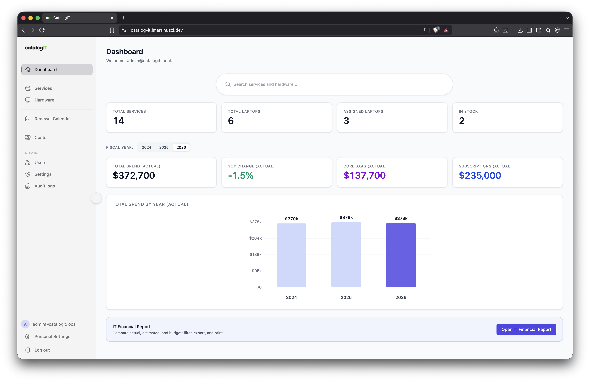
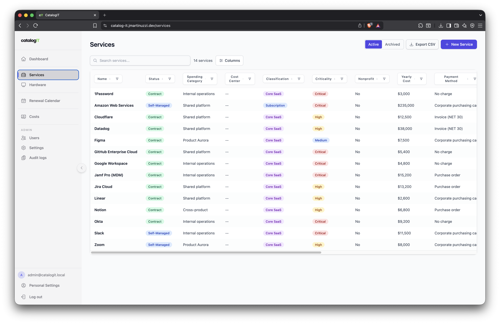
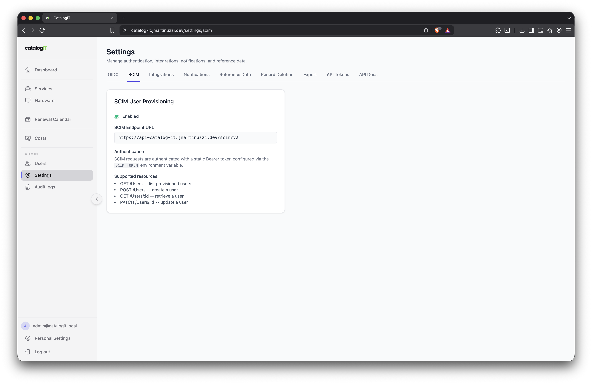

**Open-source IT service catalog and hardware inventory for modern teams.**

**[Live demo](https://catalog-it.jmartinuzzi.dev/)** — `admin@catalogit.local` / `admindemo` · sandbox resets every 12 hours

---

CatalogIT helps organizations track their SaaS subscriptions, cloud services, and hardware assets in one place. It provides cost tracking, renewal management, vendor oversight, and a full audit trail — self-hosted, with enterprise SSO and provisioning built in.

## Features

- **Service Catalog** — track services with cost, renewal dates, vendors, owners, and classifications
- **Hardware Inventory** — manage laptops, phones, tablets, accessories in bulk, and peripherals with assignments and locations ([hardware guide](docs/hardware.md))
- **Renewal Calendar** — visual calendar view for upcoming renewals
- **SSO & Provisioning** — OIDC single sign-on (Okta) with SCIM 2.0 automatic user provisioning
- **Role-Based Access** — admin/editor/viewer roles plus per-feature permissions for financial data and hardware visibility
- **Audit Logging** — comprehensive change history with configurable retention policies
- **Notifications** — renewal reminders and alerts via Gmail, Slack, Telegram, or webhooks ([email templates](docs/email-templates.md))
- **File Attachments** — attach contracts and documents to services (S3-compatible storage)
- **API Tokens** — programmatic access for automation and integrations
- **AI assistants (MCP)** — connect Claude, ChatGPT, and other MCP clients to search services, vendors, hardware, costs, history, and the audit log, and to create or update vendors, tags, and services; local stdio or hosted Streamable HTTP with API-token or OAuth sign-in ([details](#ai-assistants-mcp))
- **Backup & Restore** — complete tooling for database and object storage backups

## Live demo

A shared **[CatalogIT demo](https://catalog-it.jmartinuzzi.dev/)** is available so you can explore the app without installing anything.


|             |                                                                                          |
| ----------- | ---------------------------------------------------------------------------------------- |
| **URL**     | [https://catalog-it.jmartinuzzi.dev/](https://catalog-it.jmartinuzzi.dev/)               |
| **Sign in** | Email **admin@catalogit.local** and password **admindemo**                             |
| **Sandbox** | The instance refreshes on a **12-hour** schedule; **all data is reset** on each refresh. |


Treat it as a throwaway environment: do not store real or sensitive information.

## Screenshots

### Dashboard



### Services



### Settings (SCIM)



## Tech Stack


| Layer    | Technology                                          |
| -------- | --------------------------------------------------- |
| Backend  | FastAPI, SQLAlchemy (async), Alembic, Uvicorn       |
| Frontend | React 19, TypeScript, Vite, Tailwind CSS            |
| Database | PostgreSQL 16                                       |
| Auth     | OIDC + SCIM 2.0, local password fallback            |
| Storage  | S3-compatible (Silo in Compose, AWS S3 supported) |
| MCP      | Python MCP SDK, Streamable HTTP + stdio, httpx      |


## Quick Start

### Prerequisites

- Docker and Docker Compose
- [uv](https://docs.astral.sh/uv/) (Python package manager)
- Node.js 20+ and npm

### Setup

```bash
# Clone the repository
git clone https://github.com/jonymaster/catalogIT.git
cd catalogIT

# Configure environment
cp .env.example .env
# Edit .env with your values

# Start all services
docker compose up --build
```

Once running:


| Service            | URL                                                      |
| ------------------ | -------------------------------------------------------- |
| Frontend           | [http://localhost:5173](http://localhost:5173)           |
| API                | [http://localhost:8000](http://localhost:8000)           |
| API Docs (Swagger) | [http://localhost:8000/docs](http://localhost:8000/docs) |
| MCP (Streamable HTTP) | [http://localhost:8001/mcp](http://localhost:8001/mcp) |
| Silo Console      | [http://localhost:9001](http://localhost:9001)           |


Existing installations: see the [Silo upgrade notes](docs/releases/v1.5.2.md) before updating. Compose retains the `minio` service, storage names, and `MINIO_*` settings for compatibility.

### Database migrations

The API runs `**alembic upgrade head` automatically on startup**, so a manual step is usually unnecessary. To apply migrations yourself (for example if the container failed mid-boot):

```bash
docker compose exec api alembic upgrade head
```

### Sample data (optional)

CatalogIT can load **bundled demo data** on the **first** API startup when the database has **no services** yet (empty catalog). This is controlled by `**SEED_SAMPLE_DATA`** (see `.env.example`).


| Location                         | Role                                                                                                                                                                                              |
| -------------------------------- | ------------------------------------------------------------------------------------------------------------------------------------------------------------------------------------------------- |
| `**backend/sample_data/*.json`** | Source files in the repo (vendors, categories, payment methods, users, services including **yearly cost**, fiscal **cost records**, **service history**, **laptops**, **laptop hardware costs**). |
| **Docker API image**             | Same JSON is copied to `**/app/sample_data`**; the container sets `**SEED_DIR`** to that path.                                                                                                    |
| `**placeholder data/**`          | Symlinks to `backend/sample_data` plus `**bulk_load_api.py**` / `**purge_catalog_api.py**` for loading or clearing via the HTTP API (useful when you cannot run the DB seed script directly).     |


**Local development:** set `SEED_SAMPLE_DATA=true` in `.env`, start the stack, log in with the bootstrap admin from `.env`, and explore the pre-filled catalog and hardware.

**Production:** prefer `SEED_SAMPLE_DATA=false` after the first deploy if you do not want the demo catalog on new empty databases. The production compose file (`[docker-compose.server.yml](docker-compose.server.yml)`) defaults this to false.

**Releases:** multi-arch images are built with `**make release`** or `**docker buildx bake`** (see `[docker-bake.hcl](docker-bake.hcl)`); images are tagged with the release version and `**latest**`. For server deploys you can pin `**CATALOGIT_TAG**` (for example `1.1.1`) so `docker-compose.server.yml` pulls a specific tag instead of `latest`.

## AI assistants (MCP)

CatalogIT ships an [MCP](https://modelcontextprotocol.io/) server (`mcp/`, image `jonymaster/catalogit-mcp`) so AI assistants can query and update the catalog. The MCP server calls the CatalogIT REST API and never connects to PostgreSQL. Every request runs as the CatalogIT user who owns the credential, so roles, financial and hardware visibility, and audit attribution apply unchanged.

**Tools**

- **Read:** `list_services`, `get_service`, `list_vendors`, `list_hardware_assets`, `get_service_cost_records`, `get_record_history`, `list_audit_events` (admin only)
- **Write:** `create_vendor`, `update_vendor`, `create_tag`, `update_tag`, `create_service`, `update_service`

The MCP server cannot delete or archive records. Notes, personal contact details, and financial references are removed from results. A viewer-role token makes the connection read-only.

**Connect**

| Mode | Clients | Authentication |
| --- | --- | --- |
| Local stdio (`uv run --project mcp catalogit-mcp`) | Claude Desktop, Cursor, other local MCP clients | API token from **Settings → API Tokens** in `CATALOGIT_API_TOKEN` |
| Hosted Streamable HTTP (`https://<host>/mcp`) | Claude Code and clients that send custom headers | `Authorization: Bearer <API token>` |
| Hosted Streamable HTTP with OAuth | Claude.ai custom connectors, ChatGPT developer mode | Your own OAuth provider (for example Cloudflare Access Managed OAuth), configured in **Settings → MCP Sign-in** |

Example for Claude Code against a hosted instance:

```bash
claude mcp add --transport http catalogit https://<host>/mcp \
  --header "Authorization: Bearer $CATALOGIT_TOKEN"
```

The `mcp` service is part of both Compose stacks. The UI image proxies `/mcp` to that service, so a single public hostname serves the UI, API, and MCP endpoint. For production, set `MCP_ALLOWED_HOSTS` (required) and optionally `MCP_ALLOWED_ORIGINS` and `MCP_IDENTITY_HEADER`. See `.env.example` for these settings.

Read the full [MCP setup guide](docs/integrations/mcp.md) for client configuration, permissions per tool, OAuth setup, and troubleshooting.

## Documentation


| Topic                                                      | Guide                                                                          |
| ---------------------------------------------------------- | ------------------------------------------------------------------------------ |
| **Email templates** (subject, HTML upload, logos, preview) | [docs/email-templates.md](docs/email-templates.md)                             |
| Integrations overview                                      | [docs/integrations/README.md](docs/integrations/README.md)                     |
| MCP and AI assistants                                       | [docs/integrations/mcp.md](docs/integrations/mcp.md)                          |
| Gmail setup                                                | [docs/integrations/gmail.md](docs/integrations/gmail.md)                       |
| Slack setup                                                | [docs/integrations/slack.md](docs/integrations/slack.md)                       |
| Telegram setup                                             | [docs/integrations/telegram.md](docs/integrations/telegram.md)                 |
| Webhook setup                                              | [docs/integrations/webhook.md](docs/integrations/webhook.md)                   |
| Backup & Restore                                           | [docs/operations/backup-and-restore.md](docs/operations/backup-and-restore.md) |


## Operations

- **Logging** — the API logs to stdout. Set `LOG_FORMAT=json` for structured JSON output. On AWS ECS, use the `awslogs` driver or FireLens to ship logs to CloudWatch.
- **Renewal reminders** — connect Gmail under **Settings → Integrations**, edit templates under **Settings → Notifications** ([guide](docs/email-templates.md)), then call `POST /api/internal/notifications/renewal-dispatch` with the `X-Cron-Secret` header on a daily schedule.
- **Audit retention** — rows older than `AUDIT_RETENTION_DAYS` (default 90) are purged via `POST /api/internal/audit-retention` with the same `X-Cron-Secret` header.
- **Backups** — run `make backup-local` for a one-command database dump and bucket mirror. See [Backup & Restore](docs/operations/backup-and-restore.md) for production procedures.

## Project Structure

```
catalogIT/
├── backend/           # FastAPI application
│   ├── app/           # Source code (routers, models, schemas)
│   ├── alembic/       # Database migrations
│   ├── sample_data/   # Optional seed JSON (bundled in API image for SEED_SAMPLE_DATA)
│   └── Dockerfile
├── mcp/               # MCP adapter for the REST API (stdio + Streamable HTTP)
├── frontend/          # React (Vite) application
│   ├── src/           # Components, pages, hooks, types
│   └── Dockerfile
├── docs/
│   ├── email-templates.md  # How to customize and upload email HTML
│   ├── integrations/       # MCP, Gmail, Slack, Telegram, webhook guides
│   └── operations/         # Backup and restore procedures
├── email-templates/        # Canned HTML you can copy, edit, and upload in the app
├── branding/          # Logo assets (light/dark, horizontal/square)
├── screenshots/       # README screenshots (live demo)
├── scripts/           # Utility scripts (backup, etc.)
├── docker-compose.yml
├── docker-compose.server.yml  # Production-oriented stack (pinned images via CATALOGIT_TAG)
├── docker-bake.hcl    # Multi-arch image build (API + UI + MCP; version + latest tags)
├── Makefile           # e.g. make release — push images; make backup-local
└── .env.example       # Environment variable template
```

## Release history

Highlights from the most recent releases. Full notes on the [GitHub releases page](https://github.com/jonymaster/catalogIT/releases).

### v1.6.x — October 2026

- **MCP server:** new `mcp` service and `jonymaster/catalogit-mcp` image. AI assistants can use it to search services, vendors, hardware, and cost records over local stdio or hosted Streamable HTTP (v1.6.0).
- **MCP OAuth sign-in:** Claude.ai and ChatGPT connectors can sign in through your own OAuth provider, configured in **Settings → MCP Sign-in**. The UI image now proxies `/mcp` (v1.6.2).
- **MCP history, audit log, and write tools:** read record history and the audit log, and create or update vendors, tags, and services. Record history API now enforces per-table permissions. New `PATCH /api/services/{id}` endpoint (v1.6.3).
- **Security and maintenance:** frontend dependency updates for all open Dependabot alerts (v1.6.4). Bootstrap admin password fix for installs with several admins, CI on every pull request, and Python images built from committed lockfiles (v1.6.5).

### v1.5.2 — October 2026

- **Silo object storage:** the bundled MinIO image is replaced by Silo, a community-maintained MinIO fork. Existing installations: follow the [upgrade notes](docs/releases/v1.5.2.md) before updating.

### v1.5.0 — September 2026

- **Generic Hardware Support:** Now supporting not only laptops, but also phones, tablets, accessories and peripherals.
- Bug fixes around user search results.

### v1.4.0 — April 2026

- **Granular permissions:** new Financial view and Hardware visibility permissions, applied end-to-end across the UI and API. Admins still see everything.
- **Admin password reset:** admins can reset local users' passwords directly from the user detail page.
- Bug fixes around user search results.

### v1.3.0 — April 2026

- **User-centric navigation:** new per-user pages for owned/assigned services and assigned assets.
- **Personalized workspace preferences:** date format, dashboard defaults, column layouts persisted server-side per user.
- Rolls up five backlog initiatives with regression fixes.

### v1.2.x — April 2026

- **Visual refresh** across the product with new dashboard widgets and flexible layout.
- **Automatic notification scheduling** so renewal reminders fire without manual cron triggers.
- **Tags and yearly costs** on services, plus cost-report UI improvements.
- Deep linking between lists and detail pages for faster navigation.

### v1.1.x — April 2026

- **Cost records** replace the single yearly-cost field, with actual vs. estimated costs merged per fiscal year.
- **Point of Contact** field for services and reference-data color coding.
- Dashboard widgets, export-all, and integration disconnection.
- v1.1.0 introduced a modern UI overhaul, v1 financial permissions, hardware costs and locations.

### v1.0.0 — April 2026

First stable release: service catalog, hardware inventory, renewal calendar, OIDC + SCIM, role-based access, audit logging, notifications, attachments, and API tokens.

## Contributing

Contributions are welcome! To get started:

1. Fork the repository
2. Create a feature branch (`git checkout -b feature/my-feature`)
3. Commit your changes
4. Open a pull request

## License

CatalogIT is licensed under the [MIT License](LICENSE). See the [LICENSE](LICENSE) file for details.
